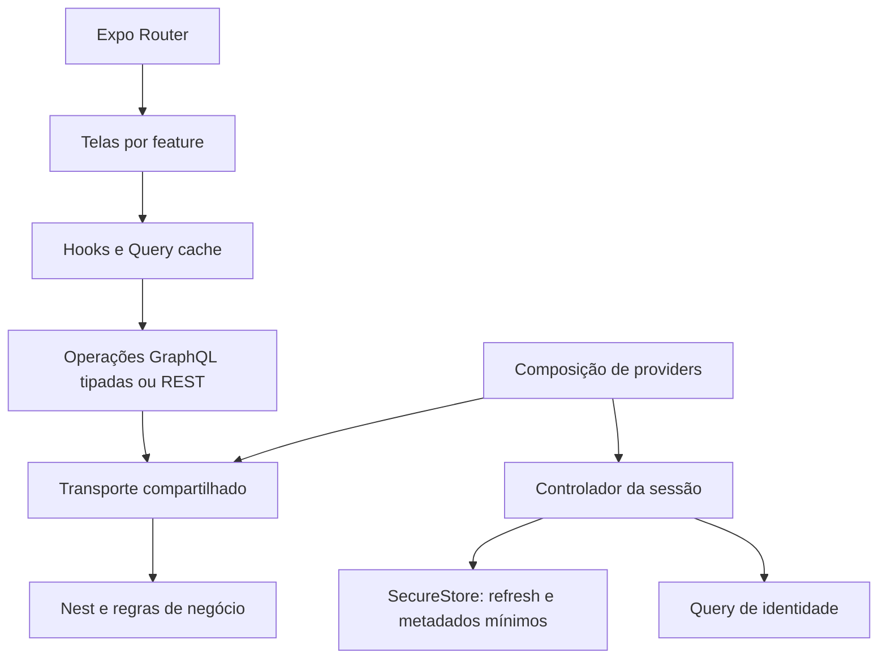

# Proposta de arquitetura mobile e decisões

Status: decisões propostas, sujeitas à aprovação. Nenhuma biblioteca foi instalada. A fundamentação do produto está no [diagnóstico](/Users/rogerio/Projetos/SindicoPro/sindicopro-mobile/docs/arquitetura/diagnostico.md).

## 1. Estrutura e limites

Organizar por funcionalidade com infraestrutura compartilhada pequena. Não reproduzir todas as camadas do Nest no cliente, nem criar repositórios abstratos sem alternativas reais de implementação. Componentes de tela consomem hooks de feature; hooks coordenam estado remoto; a API da feature define operações/adaptações; transporte e sessão são compartilhados.

```text
sindicopro-mobile/
  src/
    app/
      _layout.tsx
      index.tsx
      (auth)/sign-in.tsx
      (app)/_layout.tsx
      (app)/dashboard.tsx
    providers/
      app-providers.tsx
      query-provider.tsx
      query-lifecycle.ts
    features/
      auth/
        api/                       # operações GraphQL e adaptação de respostas
        model/                     # schema do formulário, controlador/tipos da sessão
        auth-provider.tsx
        hooks/
        screens/sign-in-screen.tsx
        components/
        __tests__/
      dashboard/
        screens/dashboard-screen.tsx
        __tests__/
    shared/
      api/                         # transporte, configuração e erros comuns
      storage/                     # implementação nativa e fallback web explícito
      ui/                          # Button, TextField, Screen, feedback
      theme/                       # tokens, temas e tipografia
      assets/                      # marca e imagens utilizadas
    graphql/generated/             # arquivos gerados, nunca editados manualmente
  graphql/
    schema.graphql
    schema-source.md               # ambiente, revisão e hash da origem
  tests/
    integration/                   # Router/providers/serviços reais, bordas simuladas
    support/                       # fixtures sanitizadas e factories
  .maestro/                        # fluxos nativos críticos na implementação
  docs/arquitetura/
  codegen.ts
```

Este desenho descreve a evolução; diretórios sem uso não serão criados. Ocorrências e tarefas só ganharão suas pastas quando entrarem no escopo. As rotas são finas: não armazenam clientes, regras de domínio, schemas de formulário ou testes.

Regras de dependência: `shared` não importa `features`; uma feature não importa telas/internals da outra; integração entre domínios usa IDs, navegação ou uma função pública específica quando necessária. Tipos gerados representam o transporte, não uma segunda cópia de entidades do backend. Adaptar apenas diferenças úteis à UI, como sentinelas e datas. Evitar barrels globais que carreguem todas as features/operations no bundle.

Auth é a feature transversal com interface pública de sessão; seu controlador não é duplicado em `shared`. A composição em `providers` conecta auth, QueryClient e transporte. O transporte recebe um leitor de credencial/coordenador por parâmetro, sem importar componentes ou módulos da feature; isso evita ciclo entre API e sessão. A fronteira também permite simular rede/armazenamento nos testes sem criar uma hierarquia de repositórios mobile.



## 2. Decisões e alternativas

| Decisão proposta | Alternativas avaliadas | Motivo e custo aceito |
| --- | --- | --- |
| D1 — TanStack Query v5 como único gerenciador de estado remoto | Apollo Client com cache normalizado; urql/Graphcache; `fetch` sem biblioteca | O produto combina GraphQL, REST de arquivos, filtros/páginas heterogêneos e ciclo de rede mobile. Query oferece cache por chave e coordenação de requisições sem acoplar o domínio a um único protocolo. Custo: não normaliza entidades; invalidação entre listas/detalhes será explícita e testada. |
| D2 — GraphQL Code Generator com `client-preset` e TypedDocumentNode | Tipos manuais; hooks Apollo copiados do web; plugin específico React Query | Contrato gerado por operação, independente de biblioteca de cache. O preset oficial reduz configuração de plugins. Não gerar hooks de cache que escondam políticas por feature. Custo: pipeline/schema precisam de manutenção e verificação no CI. |
| D3 — `fetch` nativo em um transporte pequeno e tipado | graphql-request; Apollo como transporte junto de Query; Axios/Ky | Envelope GraphQL, bearer, timeout, AbortSignal e classificação de erros são necessidades limitadas. Não criar duas fontes de cache. Se o transporte crescer além disso, avaliar graphql-request; não implementar cliente GraphQL genérico, normalização ou retry próprios. |
| D4 — Context para ciclo da sessão; Query para identidade/dados remotos | Redux/Zustand global desde o início | Context expõe status, subject/escopo e ações, sem copiar listas. Dados de usuário têm fonte única na query de identidade; tokens ficam no controlador privado da sessão. Store adicional só se surgir estado cliente compartilhado que justifique. |
| D5 — SecureStore para refresh e metadados mínimos; access token em memória | AsyncStorage para tokens; senha salva; ambos os tokens em Context persistido | Restauração por renovação evita persistir access token longo e não requer senha no dispositivo. Depende do contrato de sessão aprovado. Custo: recuperação de falhas de escrita/rotação e comportamento de Keychain precisam de testes nativos. |
| D6 — React Hook Form + Zod para formulário e fronteiras críticas | Formulário manual no login; validação só por TypeScript | Mesmos conceitos usados nos formulários complexos do produto, adaptados a inputs nativos. Zod valida formulário e resposta crítica de sessão; RHF coordena campos/erros. Não reproduzir em Zod todo o schema GraphQL. |
| D7 — StyleSheet, tokens e componentes nativos pequenos | Portar Radix/Tailwind; instalar biblioteca visual completa | Poucos componentes no primeiro incremento; controle de teclado, acessibilidade e tema sem dependência de DOM. Estender componentes conforme uso, sem construir um design system inteiro antes das telas. |
| D8 — Sessões mobile aditivas e isoladas do campo legado | Reusar login legado; corrigir apenas o segredo; migrar web/mobile juntos | Única alternativa proposta que atende a coexistência sem exigir migração imediata do Next. Precisa de aprovação/trabalho separado no Nest; nenhum contrato novo está sendo apresentado como já disponível. |
| D9 — Sem persistência de cache remoto ou fila offline de mutations neste incremento | Persistir todo o cache e enfileirar alterações | Evita guardar dados de moradores/condomínios antes de definir retenção, criptografia e conflitos. A base suporta leitura em memória e recuperação de rede; não promete operação offline do produto. |

**Avaliação de Apollo:** é adequado a React Native e tem vantagens quando muitas telas dependem de entidades compartilhadas e atualização normalizada. Aqui, normalização não resolve automaticamente listas filtradas, relatórios, recorrência e REST; essas invalidações continuariam existindo. Query foi escolhido pela política explícita e uniforme. Não é uma decisão de desempenho comprovado, nem de que relacionamentos complexos dispensem cache. Reavaliar antes de expansão se a manutenção das invalidações produzir divergências frequentes; não introduzir Apollo e Query em paralelo como solução automática.

Fontes oficiais: [TanStack em React Native](https://tanstack.com/query/latest/docs/framework/react/react-native), [Apollo em React Native](https://www.apollographql.com/docs/react/integrations/react-native), [Codegen client preset](https://the-guild.dev/graphql/codegen/plugins/presets/preset-client), [Zod](https://zod.dev/basics). A página RHF consultada respondeu 403; seu uso foi confirmado no web, mas a configuração/versão nativa deverá ser validada na implementação.

## 3. Dependências: finalidade e momento

| Pacote/grupo | Finalidade | Quando |
| --- | --- | --- |
| Expo Router, safe-area-context e módulos já instalados | Navegação e base nativa | Reutilizar SDK 58 existente. |
| `@tanstack/react-query` v5 | Uma camada de cache/estado remoto | Base do primeiro incremento. |
| `graphql`, `@graphql-typed-document-node/core` | Serialização dos documentos e assinatura de tipos | Base; importações de tipos sem custo de runtime. |
| `@graphql-codegen/cli`, `@graphql-codegen/client-preset` | Gerar tipos/documentos; desenvolvimento | Base; não são serviço de runtime. |
| `expo-secure-store`, `expo-network` | Credencial nativa e sinal de conectividade | Sessão/ciclo de requisições do primeiro incremento. |
| `react-hook-form`, `zod`, `@hookform/resolvers` | Formulários e parsing crítico | Login, com versões mutuamente compatíveis. |
| ESLint/config Expo, Jest/`jest-expo`, tipos de teste, React Native Testing Library | Lint e testes automatizados | Base do primeiro incremento. Router SDK 58 exige RNTL 14 ou mais novo conforme guia consultado. |
| Maestro | E2E em emulador/simulador/binário de teste | Verificação dos fluxos críticos; ferramenta externa, não runtime do app. |
| AsyncStorage, Zustand/Redux, biblioteca de lista adicional, push, imagem/câmera e SDK de observabilidade | Necessidades ainda fora do incremento | Não instalar agora. |

Versões exatas serão resolvidas após aprovação, verificando peer dependencies de React 19.3/RN 0.88/TypeScript 6, módulos compatíveis com SDK 58 e registrando o lockfile. Usar `npx expo install` conforme `AGENTS.md`, inclusive flags de desenvolvimento quando aplicáveis; depois executar compatibilidade/doctor. Não usar `--force` para ignorar incompatibilidade.

## 4. Contratos e transporte

Manter operações nomeadas `.graphql` junto da feature, descobertas pelo Codegen, e artefatos gerados fora de `src/app`. O mobile conterá snapshot do schema e registro da origem: serviço/ambiente, SHA do backend e hash do arquivo. Não usar a presença de um repo vizinho como requisito do build/CI. Atualizações do snapshot devem ser revisadas; não puxar silenciosamente o schema vivo no build.

Codegen deve validar todas as operações e scalars usados: datas de transporte como strings ISO, JSON desconhecido como `unknown` até parsing; nenhum scalar desconhecido vira `any`. Verificação de drift compara a geração com os arquivos versionados. Na homologação, testes exercitam as mesmas operações; schema local não garante que o servidor implantado já tenha os campos. Não copiar o arquivo de hooks Apollo do Next.

Transporte compartilhado recebe documento tipado, variáveis, `AbortSignal` e política explícita de autenticação. Obtém access token atual em memória a cada requisição; não lê SecureStore por request. Requisições de login/refresh não entram recursivamente no interceptor de renovação. `Authorization` não vai em query string. Configuração pública separa URL GraphQL/REST e ambiente; somente HTTPS fora do desenvolvimento local.

Erros padronizados: validação local, credenciais inválidas, não autenticado, proibido, rede/timeout, cancelamento, servidor, contrato inesperado e armazenamento. HTTP 200 com `errors` é falha quando a operação exige resultado completo. Autenticação rejeita dados parciais/nulos e faz parsing em runtime. Telas futuras poderão aceitar resposta parcial somente com política específica por operação. Não converter erro em lista vazia e não usar todo 403 como motivo para logout.

Redigir mensagens em português sem revelar existência de conta, stack, payloads, tokens ou caminhos internos. Logging futuro inclui operação, duração, categoria e correlação sanitizada; não inclui variáveis de autenticação, URLs de arquivos privadas ou dados pessoais por padrão. Nenhum SDK externo precisa ser instalado para padronizar erros.

Timeout inicial proposto: 15 segundos por chamada de autenticação, configurável e sujeito à homologação. Login/refresh/logout/mutations não terão retry genérico. Uma consulta de dados idempotente poderá ter até duas tentativas adicionais por falha transitória, com espera crescente; nunca para erro de credencial, permissão, contrato ou cancelamento. O tipo HTTP POST não determina idempotência de uma operação GraphQL.

## 5. Estado, cache e ciclo de vida

| Estado | Fonte única | Persistência |
| --- | --- | --- |
| Identidade, contextos, permissões e dados de domínio | Query cache; queries habilitadas segundo sessão e escopo | Memória neste incremento. |
| Ciclo de autenticação, geração da sessão, subject e ações | Controlador de sessão + Context de leitura | Refresh e metadados mínimos no SecureStore. |
| Tema/seleção de contexto | Preferência cliente; seleção só entre escopos autorizados | Tema do sistema inicialmente; seleção persistida apenas quando houver seletor validado. |
| Formulário, senha, modal, expansão e rascunho | Componente/RHF | Sem persistência da senha. |
| Rede/foco | Eventos de plataforma integrados ao Query | Não persistir. |

Uma instância estável de QueryClient por sessão ativa; recriar/limpar na troca de conta. Query de identidade alimenta o dashboard, inclusive quando sem outras métricas. Não guardar o mesmo objeto de usuário no Context e no cache.

Chaves futuras incluem ambiente, pessoa/escopo autorizado, condomínio ou agregado permitido, domínio, filtros e ordenação. Exemplo conceitual: `ambiente → pessoa → contexto → condomínio → ocorrências → lista → filtros`. Tokens nunca entram na chave. A chave inclui a pessoa efetiva que está acessando, mesmo quando o backend recebe ID do síndico responsável. Mudança de condomínio reinicia páginas, descarta respostas obsoletas e revalida a permissão; dados do escopo anterior não aparecem como placeholder.

Política inicial proposta: identidade/permissões revalidadas no bootstrap e conforme retorno ao app/necessidade de acesso; consultas operacionais futuras com `staleTime` inicial de 30 segundos e `gcTime` de 5 minutos, ajustados por feature/medição. Nenhum desses tempos concede autorização. Listas grandes têm limite de páginas em memória definido ao serem implementadas. Nada de cache infinito ou download de todos os relacionamentos.

Invalidação será declarada na feature, por operação e escopo: no futuro, mudança de tarefa invalida detalhe, listas/quadro e resumos afetados; uma tarefa ligada a ocorrência pode invalidar também seu detalhe/resumo. Recorrência invalida coleção, pois o servidor pode criar outra instância. Começar com invalidação correta; updates otimistas só com rollback/concorrência testados. Não montar um barramento genérico de eventos de domínio neste incremento.

Para paginação, preservar os contratos existentes. Em endpoints `page`/`total` usar a página real e deduplicação por ID; em endpoints sem paginação não inventar cursor/`hasNextPage`. Um adaptador de paginação só nasce quando existir endpoint usado que o justifique. Requisitar ordenação estável e recorte no servidor antes de grandes listagens; virtualização não reduz o payload da rede.

Integrar `focusManager` ao AppState e `onlineManager` ao estado inicial/eventos de `expo-network`, com cleanup. Sinal de rede não prova que a API esteja alcançável. Não recriar listeners por tela nem usar eventos `window` no nativo. Propagar AbortSignal até `fetch`; só chamar `cancelQueries` sem consumir o sinal não garante cancelar a rede. Abort de mutation não desfaz efeitos no servidor. [Ciclo React Native](https://tanstack.com/query/latest/docs/framework/react/react-native), [cancelamento](https://tanstack.com/query/latest/docs/framework/react/guides/query-cancellation), [Network SDK 58](https://docs.expo.dev/versions/v58.0.0/sdk/network/).

## 6. Autenticação: requisito e solução proposta

### Contrato existente e limite

O contrato real está no diagnóstico A1–A6. Não há uma sequência de chamadas atuais que garanta login independente por dispositivo sem tocar no refresh do web. O app não deverá usar uma API não documentada, compartilhar token web ou fazer login automático com senha persistida. O contrato legado poderá servir a ensaios isolados em homologação com conta dedicada; não é solução aprovada para coexistência.

### Contrato aditivo recomendado — ainda inexistente

Propor ao backend operações novas de criar/renovar/revogar **a sessão atual** e consultar identidade/escopos autorizados. Nomes, inputs e outputs serão definidos/revisados em trabalho separado; não gerar operações fictícias no mobile. Elas podem preservar os contratos operacionais existentes e a autenticação bearer, desde que a estratégia no Nest passe a reconhecer/validar explicitamente os novos tokens.

Requisitos para a proposta do backend:

- Registro por sessão/dispositivo com identificador, conta, refresh armazenado como hash, expiração, revogação e família/versão de rotação. Nome/ID de instalação do cliente é metadado, não prova de autorização.
- Novo login mobile não escreve `PersonAccount.refreshToken`; login/refresh/logout legados não invalidam sessões mobile sem uma ação global explicitamente aprovada. Não mudar TTL/payload dos clientes legados incidentalmente.
- Access token mobile com identificação de sessão e validade curta configurável; proposta inicial de 10–15 minutos, sujeita à política do produto. O servidor verifica sessão ativa e conta ativa/não excluída nos acessos protegidos. `sid` no JWT sem essa checagem não proporciona revogação imediata.
- Rotação transacional/atômica do refresh, proteção contra replay e revogação limitada à família comprometida; política explícita para duas renovações simultâneas e resposta de refresh perdida na rede. Se houver retry seguro, ele requer idempotência projetada no servidor, não retry genérico no app.
- Logout por sessão e separação de uma eventual ação global. Limitar tentativas de autenticação e retornar erros identificáveis sem enumerar contas.
- Identidade consistente após login/restore: conta, pessoa e dados mínimos de escopo/perfil necessários ao produto. A consulta deve derivar o ator da sessão, sem aceitar ID arbitrário como autorização.
- Implantação aditiva, regressão dos clientes legados e rollback que interrompa apenas o novo fluxo, sem apagar credenciais web.

Essas recomendações seguem princípios de [gestão de sessões OWASP](https://cheatsheetseries.owasp.org/cheatsheets/Session_Management_Cheat_Sheet.html) e [proteção/rotação de refresh tokens no RFC 9700](https://www.rfc-editor.org/rfc/rfc9700.html); não afirmam que o login proprietário atual implemente OAuth.

### Comportamento do app após aprovação do contrato

1. Bootstrap lê credencial mínima versionada no SecureStore e restaura por refresh; sucesso grava a credencial rotacionada antes de publicar sessão e carrega identidade/escopos. Falha temporária mostra recuperação, preserva a credencial e mantém a área protegida bloqueada até confirmar a sessão. Splash não fica preso indefinidamente.
2. Login valida entrada, evita submissão duplicada e limpa senha após uso bem-sucedido. Se persistência falhar, não declara sucesso durável; tenta revogar só a sessão recém-criada e apresenta recuperação sem guardar senha.
3. Renovação é coordenada por uma única promise por sessão. Requisições aguardam a mesma renovação; o controlador não reexecuta mutations de negócio que possam ter sido aplicadas. Identifica expiração antes do envio quando possível e deixa replay de operação estritamente limitado a caso seguro definido pelo contrato.
4. Refresh revogado/expirado exige login; falta de rede não vira revogação. Timeout de refresh com rotação potencialmente aplicada é resultado indeterminado: usar recuperação idempotente somente se existir no servidor; caso contrário pedir reautenticação, sem loop de reuso do token antigo.
5. Logout incrementa a geração da sessão, bloqueia UI, cancela leitura/operações obsoletas e limpa QueryClient. Em conexão disponível tenta revogar a sessão atual com espera limitada; limpa credenciais locais independentemente do resultado remoto. Offline, informa que a saída é local e a revogação remota não foi confirmada. Não prometer revogação online quando não houve comunicação.
6. Falha ao remover SecureStore mantém estado bloqueado com erro explícito e nova tentativa; nunca afirmar limpeza concluída. Troca de usuário só publica nova sessão após eliminar credenciais/estado anterior. Respostas/refresh tardios têm sua geração conferida antes de qualquer escrita ou publicação.

SecureStore conterá refresh, identificador de sessão e versão do formato/ambiente, sem perfil inteiro. Access token permanece em memória; telas não recebem tokens por props/URL. Testar tamanho do item, escrita/rotação, indisponibilidade do armazenamento e reinstalação: no iOS o Keychain pode sobreviver à desinstalação. A versão web de apoio terá armazenamento em memória e comportamento de restauração diferente, explícito; ela não substitui o produto Next existente. [SecureStore SDK 58](https://docs.expo.dev/versions/v58.0.0/sdk/securestore/).

## 7. Navegação, permissões e experiência

Usar Expo Router com grupos `(auth)` e `(app)`, stack protegida pela sessão confirmada e navegação interna tipada. Ao reabrir/deep link sem sessão, autenticar primeiro; só aceitar destino interno conhecido e autorizado, sem redirecionamento para URL arbitrária. Params carregam IDs/filtros pequenos, não tokens nem objetos completos. Stack protegido retira histórico inacessível; autorização de dados continua no servidor. [Autenticação](https://docs.expo.dev/router/advanced/authentication/), [rotas protegidas](https://docs.expo.dev/router/advanced/protected/).

No futuro, grupos de navegação terão stacks de cada módulo e detalhes por ID. Tabs só serão adicionadas quando houver módulos reais. A seleção de contexto/condomínio delimitará navegação e cache; deep link de outro condomínio exige comprovar acesso. Contexto ou permissão desconhecida não libera ação. Não criar role única a partir de `isEmployee`, nem reconstruir a matriz do Nest no app. Perfis do primeiro lançamento e experiência para fornecedores/funcionários ainda exigem decisão de produto.

Dashboard inicial exibe nome/identificação da pessoa conectada e Sair, sem números fictícios, listagens operacionais ou ações sem implementação. `showPanel`/permissões continuam relevantes quando forem incluídos indicadores. A tela básica de identidade não será tratada como concessão das métricas do painel web.

Interface: tokens semânticos de marca, superfícies/textos/estados em claro/escuro, logos adaptados a ativos nativos, espaçamento/tipografia coerentes. Verde da marca é referência, não garantia de contraste. Validar contraste dos controles, VoiceOver/TalkBack, fonte ampliada, foco de erro e feedback acessível. Usar safe areas, teclado apropriado, autofill, botão de senha com rótulo e alvos de toque de pelo menos 48 dp. Textos em português, sem bloquear dimensionamento de fonte.

Componentes iniciais: tela com safe area/rolagem, campo com rótulo/erro, botão com loading, feedback recuperável e estado vazio. Não criar links de cadastro/recuperação sem fluxo real. Não bloquear toda a UI durante refetch quando já houver dados válidos do mesmo escopo; restauração inicial e troca de pessoa continuam bloqueantes.

## 8. Qualidade e evolução incremental

TypeScript estrito, lint Expo com flat config, regras de hooks/imports e testes de comportamento. Jest/`jest-expo` para unidade e integração com React Native Testing Library; integração de navegação com `expo-router/testing-library`. Testes fora de `src/app`. RNTL 14+ para Router SDK 58 conforme [guia de testes do Router](https://docs.expo.dev/router/reference/testing/). [Jest no Expo](https://docs.expo.dev/develop/unit-testing/).

Codegen/validação de contrato em CI, fixtures sanitizadas de erros reais e E2E nativo de login/restore/logout. Não usar cobertura percentual arbitrária como substituto dos casos críticos. As etapas e a matriz objetiva estão no [plano do incremento](/Users/rogerio/Projetos/SindicoPro/sindicopro-mobile/docs/arquitetura/incremento-login.md).

Evolução prevista, sem implementação antecipada:

- **Ocorrências:** feature com lista/detalhe/respostas/filtros, dados mínimos por tela e catálogo sob demanda; paginação depende de contrato do servidor. Regras de congelamento/fechamento permanecem no Nest.
- **Tarefas:** lista nativa antes de reproduzir um quadro DOM; query por quadro/filtros e detalhes/comentários separados. Movimentação invalida escopos afetados; recorrência e autoria no backend. Interações otimistas dependem de contrato de concorrência/rollback.
- **Condomínios/moradores/enquetes:** mesma fronteira por feature, chaves por identidade/contexto/condomínio e acesso comprovado; sem compartilhar cache entre pessoas.
- **Arquivos:** adaptador REST/multipart nativo, seleção/permissões do dispositivo e progresso conforme necessidade. Rever proteção do endpoint antes de integrá-lo.
- **Notificações:** cadastro de dispositivos e push Expo/APNs/FCM como nova capacidade do backend, independente do Web Push. Evento só invalida dados; sempre confirmar acesso ao destino.
- **Offline e sincronização:** eventual projeto com retenção/criptografia, conflitos e idempotência, antes de persistir cache sensível ou enfileirar mutations.

Expo/EAS: manter CNG, configurar nativo via app config/plugins e validar com development build do SDK 58; não editar `ios/`/`android/` manualmente. Distribuição interna, assinatura e EAS Preview podem ser configurados quando houver necessidade de entregar binário. Nenhum build remoto, publicação ou canal de produção será criado nesta investigação. [Referência SDK 58](https://docs.expo.dev/versions/v58.0.0/).
